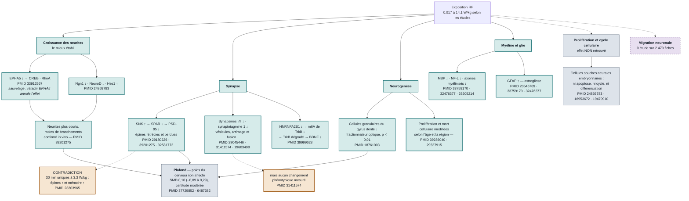

# Schéma des mécanismes

Lecture du diagramme : un trait plein marque une chaîne répliquée ou testée causalement,
un trait pointillé une chaîne reposant sur une seule étude. Les encadrés gris sont les
effets **non retrouvés**. Aucun maillon n'est dessiné qui ne vienne d'une fiche lue.

## Les quatre choses à retenir du schéma

1. **Un seul maillon a été testé causalement.** Rétablir la signalisation EPHA5 annule
   l'inhibition des neurites (PMID 33912567). Partout ailleurs, on observe une corrélation
   entre une exposition et un marqueur.
2. **La prolifération n'est pas la cible.** Trois études nulles sur les modèles les plus
   pertinents, dont une conçue pour la question sur des cellules souches neurales
   embryonnaires (PMID 24869783, 16953672, 19479910).
3. **Deux dissociations marqueur / fonction.** Les vésicules présynaptiques bougent sans
   conséquence phénotypique (PMID 31411574) ; les épines et PSD-95 bougent alors que le
   poids du cerveau ne bouge pas (PMID 37729852).
4. **Les chaînes établies convergent vers 4 W/kg**, bien au-dessus des niveaux
   environnementaux — et aucun modèle humain ne permet de les vérifier.

Version interactive, avec la dosimétrie par maillon :
https://claude.ai/artifact/Xb6uQmbBASog6r7rb5R5X1

Synthèse complète : [[synthese-neurogenese-synaptogenese-migration]]
